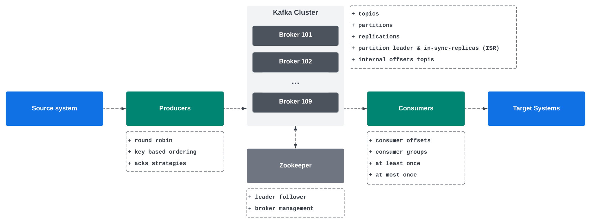
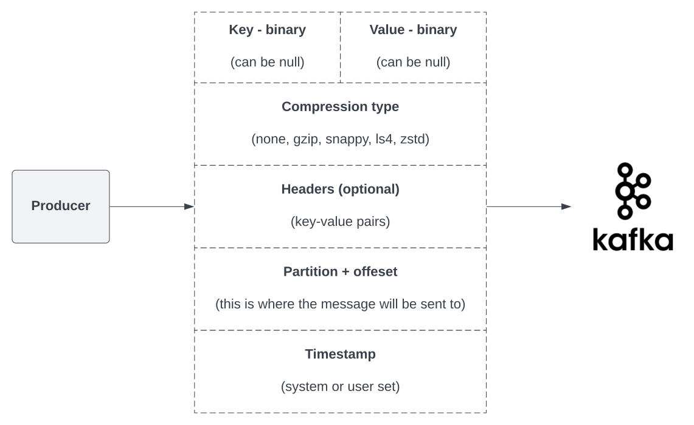

# Kafka



### 1. Problem to solve

Many programs need to integrate between various systems (ETL).
When there are n-systems on one side and m-systems on another, you can end up with n*m integrations to implement and
maintain.

Kafka makes it easier, **it decouples data streams & systems**:

* **source systems** create (produce) the data and put it to Kafka.
* **target systems** receive (consume) the data from Kafka.

Use cases:

* Messaging system.
* Activity tracking.
* Gathering metrics from different locations.
* Application logs processing.
* Streams processing (with the Kafka Streams API for example).

### 2. Topic

Topic is a stream of data.

* It is like the table in the database (without all the constraints).
* Identified by the **name**.
* Any kind of message format.
* The sequence of messages is called **data stream**.
* You cannot just query topics. Use `Kafka Producers` to send the data and `Kafka Consumers` to read the data.
* Data in Kafka is kept for limited time (default is one week, it is configurable).

### 3. Partitions and offsets

Topics are split into partitions.

* When a producer sends a record, it's written to exactly one partition of the topic.
* Messages within each partition are ordered within partition.
* Each message within partition gets an incremental ID, called **offset** (0, 1, 2, 3...).
* **Kafka topics are immutable, once data is written to a partition, it cannot be changed.**
* Offset has a meaning only within a specific partition, but it is not re-used (even if the data is cleared, the IDs
  increase).
* The key's hash, the sticky partitioner, or an explicitly given partition number decides which one.

### 5. Message keys

Producers can send a key with the message (string, number, binary, etc.)

* If `key = null`, data is sent using **sticky partitioner** - it sends to one partition until the batch is full or
  `linger.ms` passes, then switches to another. The aim is fewer, bigger batches, which means less overhead and lower
  latency.
* If `key != null`, then all the messages with that key will go to a specific partition (uses hashing for this).
* Keys are typically sent if you need message ordering for a specific field (ex. `truck_id`).

### 6. Kafka message

Kafka accepts only bytes as input and will output bytes.



* You need a serializer for both the key and the value.
* Kafka comes with a set of Common Serializers.

### 7. Kafka message key hashing

The Kafka Partitioner takes a record and determines which partition to send it into.

* The process of determining the mapping of a key to the partition is the **Key Hashing**.
* In the default Kafka Partitioner, the keys are hashed using the murmur2 algorithm.

```
targetPartition = Utils.toPositive(Utils.murmur2(keyBytes)) % numPartitions;
```

where:

* `% numPartitions` - partitions are numbered from 0 to n-1 so `% n` gives exactly the right range.
* `Utils.toPositive` - clears the sign bit (`hash & 0x7fffffff`). It is not `Math.abs` because
  `Math.abs(Integer.MIN_VALUE)` is still `Integer.MIN_VALUE`.

What is important is that **partition depends on `numPartitions`, so adding partitions moves existing keys to other
partitions and ordering per key breaks across that change**.

### 11. Delivery semantics

By default, Java Consumers will automatically commit offsets (at least once). If want you do this manually, you can
choose:

* At least once (usually preferred):
    * Offsets are committed after the message is processed.
    * If the processing goes wrong, the message is read again.
    * There can be duplicate processing of a single message, so make sure the processing is **idempotent**.
* At most once:
    * Offsets are committed as soon as the message is received.
    * If something goes wrong, some messages are lost (received, but not processed, will not be read again).
* Exactly once:
    * For [Kafka -> Kafka] workflows: use Transactional API (easy with Kafka Streams API).
    * For [Kafka -> External System] workflows: use an **idempotent** consumer.

### 12. Kafka Brokers

Broker is a server. A Kafka cluster is composed of multiple brokers.

* Each broker is identified with its ID (integer).
* Each broker contains certain topic partitions.
* After connecting to any broker (called a bootstrap broker), you will be connected to the entire cluster (Kafka clients
  have smart mechanics for that).
* Good number to start is 3 brokers; big clusters have over 100 brokers.
* So data is spread by brokers. This is the horizontal scaling in Kafka.

### 13. Kafka Broker Discovery

Every Kafka broker is also called a "bootstrap server".

* You need to connect to one broker, Kafka clients will know how to be connected to the entire cluster (smart clients).
* Each broker knows about all brokers, topics and partitions (metadata).

Steps:

1. Kafka client connects to one of the Brokers with a Metadata Request.
2. The Broker returns a list of all brokers, which broker has which partition etc.
3. The client connects to the right broker to produce or consume data.

### 14. Writing and reading data

* The producer needs to provide the Kafka client with any broker from the cluster and topic name. The Kafka Client will
  route the data to the appropriate brokers and partitions.
* The consumer needs to provide the same - any broker to connect to and the topic name. The rest will be covered by the
  Kafka itself.

### 15. Kafka Topic Replication Factor

Topics should be stored at more than one Kafka broker.

Replication factor 3 means **3 replicas** of each partition, each on different broker. One of the three is the
**leader** and the other two are **followers**. The **leader counts as a replica**.

* The replication factor should be > 1 (usually between 2 and 3).
* If a broker is down, another broker can serve the data.
* One broker is typically a leader for some partitions and a follower for other at the same time.
* Brokers replicate from other brokers. More specifically, for each partition, its followers fetch from its leader.
  Naturally, for a single partition, the leader and the follower will always reside on different brokers.
* For each partition, there is only ONE broker that is the **leader**.
* Producers can only send data to the broker that is leader of partition.
* (By default) Consumers can only read from the leader of partition. However, since Kafka 2.4, it is possible to
  configure consumers to read from the closest replica.

#### 15.1 In-sync Replicas (ISR)

In-sync replicas is the set of replicas of one partition that are caught up with the leader, **the leader included**.

#### 15.2 Replication

1. Followers **pull** from the leader, the same way a consumer does. They keep sending fetch requests: "give me
   everything after offset X".
2. The end of the leader's log is called the log end offset (LEO), which is the offset the next message will get.
3. Caught up means that at some point within the last `replica.lag.time.max.ms` (default 30s) the follower fetched
   everything up to the leader's LEO. The leader keeps track of when that last happened for each follower. If it was
   longer ago than 30s, the follower is dropped from the ISR.

#### 15.3 Resetting the lag/dropping from ISR:

The leader compares against the LEO **at the time of the follower's previous fetch**. So the `lastCaughtUpTime` is
stored per follower and moved forward when:

* The follower fetches from an offset >= the leader's current LEO (it is fully at the end).
* The follower fetches from an offset >= the leader's LEO as of the previous fetch.

So the follower does not neccesarily have to stay in 100% sync with the leader - it just has to fetch everything that
was
available on the previous fetch:

- t₁: the leader's LEO is 1000. The follower fetches from 900 and gets 900–999 back.
- t₂: the leader's LEO is 1100. The follower fetches from 1000. Since 1000 ≥ the LEO at its previous fetch (1000), it
  had everything the leader had at t₁, so lastCaughtUpTime = t₁.
- If instead it fetches from, say, 950 at t₂ (it applied only part of what it got), then lastCaughtUpTime stays as it
  was. If that goes on for 30 s, the follower is dropped.

Even if the follower is dropped from ISR, it stays a replica the whole time.

#### 15.4 `min.insync.replicas` setting

This sets how many ISR members must have a write before an `acks=all` write succeeds. If the ISR is smaller than that,
the producer gets `NotEnoughReplicasException`. Reads still work.

The standard setup is `replication_factor = 3`, `min.insync.replicas = 2`, `acks = all`. Losing 1 broker means no data
loss and writes keep working. Losing 2 means no data loss, but writes stop. Losing 3 means all replicas and the data is
gone.

#### 15.5 High watermark

| Replica    | Has offsets |
|------------|-------------|
| Leader     | 0–999       |
| Follower A | 0–979       |
| Follower B | 0–989       |

The high watermark (HW) is the first offset that not every ISR member has yet. Here it is 980:

* Offsets 0-979 are on all three replicas,
* Offsets 980-989 are on the leader and Follower B.
* Offsets 990-999 are only on the leader.

**Consumers get only 0-979.** Messages 980-999 exist only on the leader and/or one of two followers, but a consumer
isn't given them yet.

Why:

1. A consumer reads offset 995 and does the work (e.g. sends some money transfer).
2. The leader crashes.
3. A new leader is chosen from the ISR, say Follower A. It has only up to 979.
4. Offsets 980-999 no longer exist. The partition continues from A's end, so the next new messages gets offset 980
   again.
5. The consumer has acted on a message that is now gone from Kafka.

**With the HW, a consumer only ever sees messages that are on every in-sync replica.** Whichever of them becomes leader
has those messages, so **what a consumer has seen can never disappear**.

Why it matters and how it ties with `acks=all`. The producer gets its acknowledgement when the HW passes its message. At
that point the message counts as **committed**. So **acknowledged to the producer** and **visible to consumers** happen
at the same moment.

What if the new leader (Follower A) has lower offset than other follower (Follower B):

* When Follower A becomes the leader, the last offset is 979.
* Follower B will truncate the log back to 980, throwing away 980-989 and then copy from A.
* The old leader does the same when it comes back - it throws away 980-999.
* What about offsets 980-999:
    * They were never **committed**.
    * No consumer ever saw them. That's exactly what the HW guaranteed.
    * For producers:
        * With `acks=all`, the producer never got an acknowledgement for them. It gets a timeout or an error then
          **retries** and the idempotent producer makes sure the retry isn't stored twice.
        * With `acks=1`, the producer **did get an acknowledgement** from the old leader. Those messages are now
          silently lost. **That's the "limited data loss" of `acks=1`**.

### 17. Topic Durability

The topic durability is strongly linked with the chosen replication factor.

* For a topic with replication factor of 3, the topic can withstand the loss 2 brokers.
* For replication factor of N, we can permanently lose up to N-1 brokers and still have the data.

### 18. Zookeeper

Zookeeper is the software used to manage brokers. In Kafka 4 it has been removed.

* Zookeeper manages brokers (keeps a list of them).
* Zookeeper helps in performing leader election for partitions (one leader dies -> another is elected).
* Zookeeper sends notifications to Kafka in case of changes (eg. new topic, broker dies, broker comes up, deleting
  topics, etc.).
* Zookeeper by design operates with an odd number of servers (1, 3, 5, 7).
* Zookeeper has a leader (writes); the rest of servers are followers (reads).
* **Zookeeper does NOT store consumer offsets since Kafka v0.10, they are stored in a separate, internal topic.**

Kafka versions:

* Kafka 2.x can't work without Zookeeper.
* Kafka 3.x can work without Zookeeper (KIP-500) - using Kafka Raft.
* Kafka 4.x does not work with Zookeeper.

### 19. Using Zookeeper

**Kafka Brokers use Zookeeper until Kafka version 4.0.**

**Kafka Clients (consumers, producers, administration clients) have been migrated to use the brokers as the connection
endpoint. They should not use Zookeeper.**

* Since Kafka 0.10, the consumers store the offset in Kafka, not Zookeeper.
* Since Kafka 2.2, the `kafka-topics.sh` CLI command references Kafka brokers, not Zookeeper for topic management.
* **Zookeeper is less secure than Kafka.**
* **Zookeeper ports should only be opened to allow traffic from Kafka brokers, not the Kafka clients.**
* Zookeeper has some scaling issues when Kafka clusters have > 100,000 partitions.

### Raft Protocol

This protocol has been introduced to allow removing Zookeeper as a dependency.

* Quorum Controller - one of the brokers is the Quorum Leader.
* Everyone (brokers, clients) connect to the brokers, there is no software managing this (like Zookeeper).