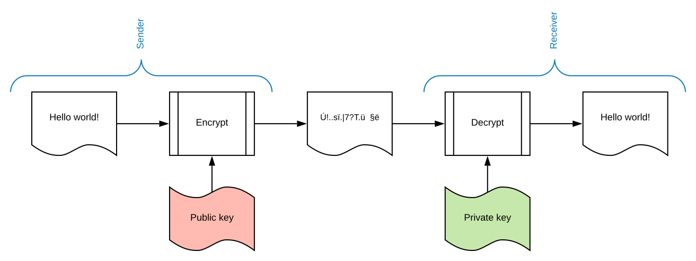
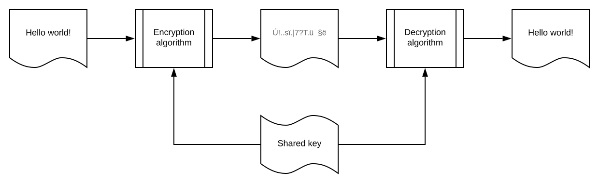
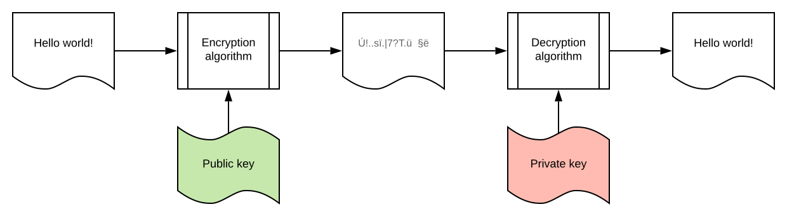

# Security basics

## Authentication vs. Authorization

* **Authentication** - verification of the credentials of the connection attempt. The remote access client sends the
  credentials to the remote access server in an either plaintext or encrypted form using **authentication protocol**.
* **Authorization** - verification that the connection attempt is allowed.

**Authentication is stating that you are who you are and authorization is asking if you have access to a certain
resource.**

## Encoding, hasing, encrption and signing

The difference between these four is one question: **can the original be received back and what do you need for
this?**.

* **Encoding** - transforms an input into a form of data that fits some specification e.g. can travel through a channel
  that accepts a limited set of characters. There is no protection, it can be reversed by anyone.
    * Binary data inside JSON or URL.
    * Base64 encoding.
* **Hashing** - transforms an input into a shorter, fixed-size value. **This is one-way.** The input can be guessed, so
  if the input itself is guessable, then hash with some salt and use slow algorythms to make each attempt costly. The
  same inputs result in the same hash, but a tiny change should produce a different one. **Good for checking.**
* **Encryption** - transforms an input into a hidden form that only the holder of a secret can read. It is reversible,
  provided that you know the secret.
* **Signing** - transforms an input and a secret (a private key or shared secret in HMAC) into a short value
  (signature), usually by hashing the input first. The input itself is not changed and stays readable, a signature is
  sent along. Anyone with a matching key (public key or shared secret) can check it. A single changed character in the
  input makes the check fail.

|            | Reversible?       | Needs a key?             | Protects against                                                                                   |
|------------|-------------------|--------------------------|----------------------------------------------------------------------------------------------------|
| Encoding   | yes, by anyone    | no                       | nothing; it only changes the format                                                                |
| Hashing    | no                | no (a salt is not a key) | nothing by itself; it is used to check values and to build signatures                              |
| Encryption | yes, with the key | yes                      | being read                                                                                         |
| Signing    | not applicable    | yes                      | changes in the input and getting data from the wrong party (with some notes about HMAC, see below) |

## Signing vs. encryption

### Signing

#### Signing using asymmetric cryptography

**You use your private key to generate message's signature and they use your public key to check if it is really yours
and if the message has not been changed**.

Examples: RSA, ECDSA.

#### Signing using symmetric cryptography

**There is one shared secret. The sender and the receiver use the same key. No way to really prove who sent the message,
because it could be either the sender or the receiver.**

Examples: HMAC.

### Encryption

**You use their public key to write message and they use their private key to read it.**

Usages:

* generating a message that can be read only by private key owner.

### Signing usages

Usages:

* Checking if the sender is who is claims to be.
* Checking if the message has not been modified by third-party.
* Generating information that only you can generate (product-keys).

These usages have important notes:

* All three usages hold mostly in asymmetric cryptography, because the signer is the only party that holds the secret
  (private key).
* With the symmetric cryptography, it is more complicated. All verifiers share the same secret. This is why, the usages
  hold when the one who signs and checks is the same party or two parties that trust each other. But then you most
  probably do not need to verify who signed.

Why use symmetric cryptography signing then:

* It is simple.
* It is fast and the output is small.
* Typical usages:
    * Session cookie or token issued and verified by the same app.
    * Webhooks - GitHub or Stripe signing a call that you can verify - you both hold the same secret.

## Cryptography types

### Symmetric encryption

**Process of encoding a message using the same key for both encoding and decoding.**

### Asymmetric encryption

**Process of encoding a message using one key - public key to encrypt and another key - private key to decrypt.**

## Token types

* **By reference** - like a credit card. A third service is required to know the person (here: account balance) from the
  token.
* **By value** - like a banknote. The only thing to be checked is if the token has not been forged (like a banknote).

## Useful information

* [100% Stateless with JWT (JSON Web Token) by Hubert Sablonnière](https://www.youtube.com/watch?v=67mezK3NzpU)
* [Deconstructing REST Security by David Blevins](https://www.youtube.com/watch?v=9CJ_BAeOmW0)
* [David Blevins: Deconstructing and Evolving REST Security 1/2](https://www.youtube.com/watch?v=_wWxfZxCQfQ)
* [David Blevins: Deconstructing and Evolving REST Security 2/2](https://www.youtube.com/watch?v=osQmFNm0YDU)
