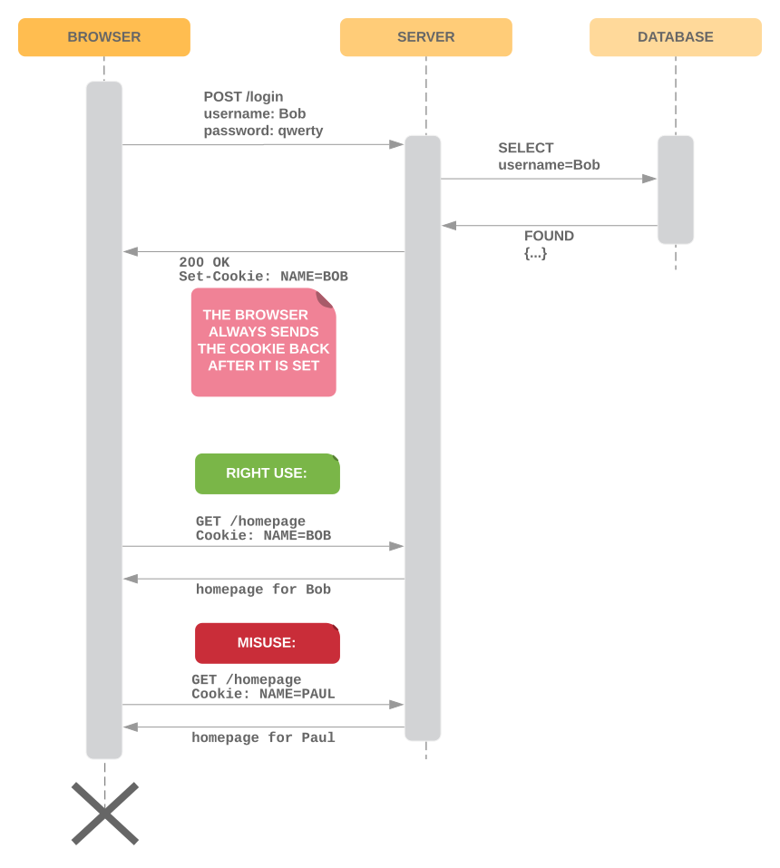
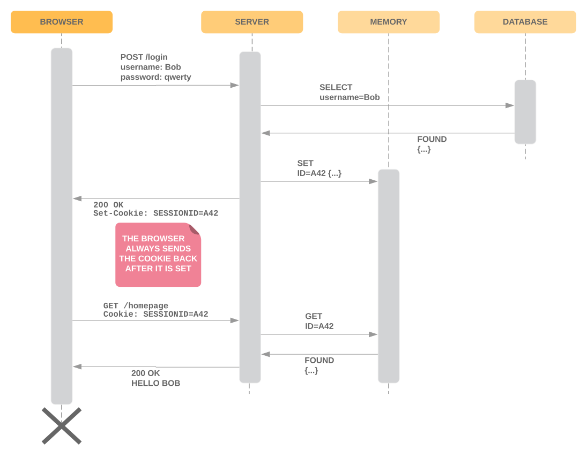
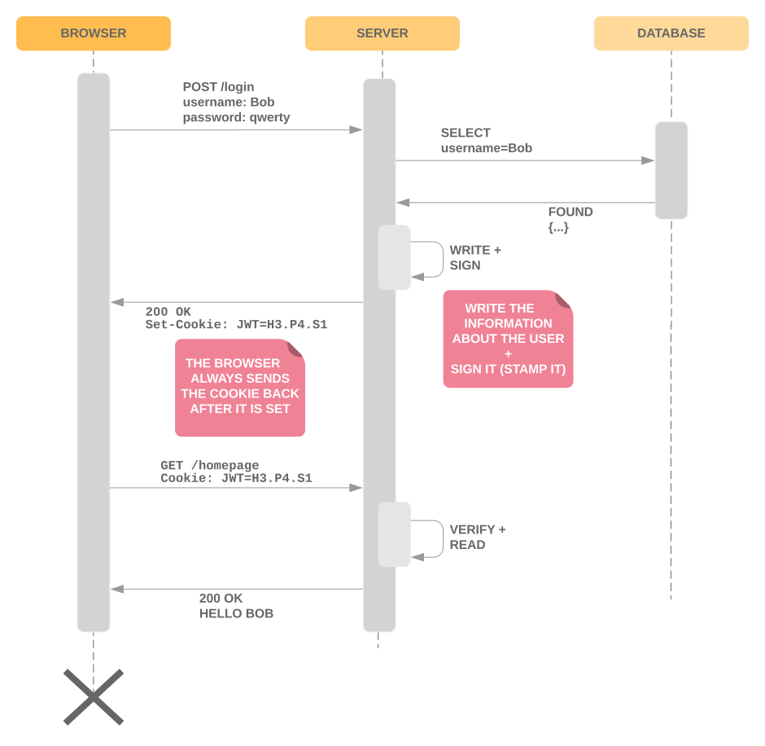

# JSON Web Tokens

## Before JWT

### Step 1 - Netscape, HTTP cookies



* The server sets the cookie with user name in the browser.
* The browser just sends the cookie back each time.
* Potential misuse - the server does not have any way to trust what it receives. It can easily be tricked into thinking
  that the person is a different one.

### Step 2 - session identifiers



* The session ID is transformed into user data by third-party service (`memory` on diagram).
* If there are many servers behind the load balancer, each server has its own memory and session IDs are not shared.

Resolutions for many server issue:

* Shared cache - it works, but it is a single point of failure, all requests go the same way.
* Distributed cache - better than the shared cache. However, this can be a problem in many organizations.
* Sticky sessions - in the load balancer, each session is linked with one node. This way, it knows about all required
  session IDs.

Usually we use two solutions at a time - sticky sessions and distributed cache.

## JWT Mechanism

* This is the third step in the way described above.
* **This is a specification, a standard, therefore it can be used with any language.**
* **Instead of storing the information at the server side, do it on the client side!**
* **There is no platform of comparison between JWT and Cookies or between JWT and OAUTH2!**
* **In its basic form, it is stateless.**
* JWT can be compared to Session IDs.
* JWT can be used using Cookies.



* The server writes the information about the user and then signs it, to make sure it can verify it afterwards.
* THERE IS NO ENCRYPTION, there is signing:
    * Base64URL-encode the header and the payload.
    * Join them together: `encodedHeader.encodedPayload`.
    * Compute a signature over that string.
        * The signature can be computed using symmetric or asymmetric signatures.
        * Symmetric signatures means HS256 so HMAC-SHA256. This naturally works only if you do not share the secret,
          e.g. one service issues and verifies its own tokens.
        * Asymmetric signatures means SHA-256 and then RSA signature or SHA-256 and then ECDSA signature.
    * Base64URL-encode the signature.

| Layer                                          | What it says about the algorithm                                                                                 |
|------------------------------------------------|------------------------------------------------------------------------------------------------------------------|
| JWT / JWS                                      | Nothing: any registered `alg` is allowed, including `none` (unsigned).                                           |
| JWA                                            | Lists the algorithms. Only `HS256` is mandatory for libraries to implement; `RS256` and `ES256` are recommended. |
| OpenID Connect                                 | ID tokens are signed with `RS256` by default.                                                                    |
| JWT access token profile for OAuth2 (RFC 9068) | Tokens must be signed, `none` is forbidden, `RS256` support is required, and asymmetric signing is recommended.  |

## Message parts

JWT is a part of the JOSE (JSON Object Signing and Encryption) family of specs: JWS (signed message), JWE (encrypted
message), JWK (key format), JWA (algorithms) and JWT (claims). The three-part message below is formally a JWS that
carries JWT claims.

### 1. Header

Header claims:

* `alg` - algorithm used to sign the message, e.g. `HS256`, `RS256`.
* `typ` - type of the token, usually `JWT`.
* `kid` - key ID - which key was used to sign the message.

### 2. Payload

Payload consists of claims. There are registered claims, which have a specific meaning. The presence and contents of the
registered claims depends on the context. Registered claims:

* `iss` - issuer - who signed the token/who printed the banknote;
* `sub` - subject - login, email or similar;
* `aud` - audience - you can target the token to specific audience;
* `exp` - expiration time - when the token will expire - a date from when the token should not be trusted;
* `nbf` - not before - this, with expiration time specifies the validity period of the token;
* `iat` - issued at.
* `jti` - JWT ID - unique id to all the generated tokens.

After these claims, there can be private claims, eg.:

* `name` - name of the user;
* `permissions` - permissions of the user.

### 3. Signature

For example, if `"alg": "HS256"` the following function will be used to generate the signature:
`hmacSha256(encodedHeader + "." + encodedPayload, "secret");`.

## Example message

### Encoded

```
eyJhbGciOiJIUzI1NiIsInR5cCI6IkpXVCJ9
  .eyJzdWIiOiIxMjM0NTY3ODkwIiwibmFtZSI6IkpvaG4gRG9lIiwiaWF0IjoxNTE2MjM5MDIyfQ
  .SflKxwRJSMeKKF2QT4fwpMeJf36POk6yJV_adQssw5c
```

*Breaklines added to enhance readability.*
*Encoded header, encoded payload and signature are divided by the dot.*

### Decoded

1. Header:

```json
{
  "alg": "HS256",
  "typ": "JWT"
}
```

2. Payload:

```json
{
  "sub": "1234567890",
  "name": "John Doe",
  "iat": 1516239022
}
```

3. Signature
   `SflKxwRJSMeKKF2QT4fwpMeJf36POk6yJV_adQssw5c` is the output of the function:

```
HMACSHA256(
  base64UrlEncode(header) + "." +
  base64UrlEncode(payload),
  your-256-bit-secret
)
```

The resultant signature is used to trust the payload. **If anything changes in the payload, the signature will change
and the server should reject the message!**

## Miscellanea

### Signing the message

There are two ways of signing the message:

* symmetric - the secret is shared among nodes/services - **not necessarily secure**;
* asymmetric - a security provider is used with a **private key**, public key is shared.

With asymmetric signing, the issuer publishes its public keys as a JWKS (JSON Web Key Set) under a URL, e.g.
`/.well-known/jwks.json`. The verifying service fetches the keys, caches them and picks the one matching the `kid` from
the header.

### What about OAUTH2 and OPEN-ID connect

See [OAUTH2](oauth2.md).

**In the OAUTH2 the access token can be a JWT.**

**In the OPEN-ID connect the `id token` is a JWT!**

### Benefits

* Minimal overhead - just add a processor to every used node to encode/decode the message.
* Microservices can be used.

### Drawbacks

#### Tokens revocation

At some point you have to revoke a token, without revoking all of them. The token can't be revoked before it expires
without adding state.

Ways to fix this:

* Have a blacklist where you add logged out apps.
* Have a very short-lived access tokens and then refresh tokens stored in the app. After you remove the refresh token,
  the access will be removed when the access token expires.

#### Claims go stale

A permission removed from a user stays in their token until it expires.

#### Public payload

The payload is readable by anyone, so nothing secret can go in it.

### Security threats

TODO expand.

- alg: none and algorithm confusion, from two messages ago.
- A weak HS256 secret, which can be brute-forced offline from a single captured token.
- Skipping validation of exp, aud or iss, so a token issued for another service is accepted.
- Where the browser keeps the token: localStorage is exposed to XSS, a cookie to CSRF.